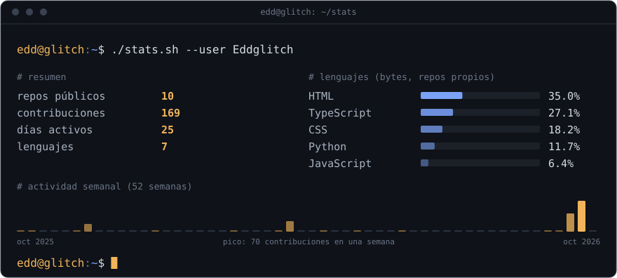

<div align="center">





</div>

### `~$ cat about.md`

Desarrollador independiente y arquitecto de sistemas de IA. Diseño e implemento sistemas RAG listos para producción, orquestación de agentes y automatización, con preferencia por herramientas que corren en local.

### `~$ ls stack/`

```text
stack/
├── ia/               rag · agentes · llms aplicados · chromadb
├── automatizacion/   n8n · servidores mcp · gemini cli
├── backend/          python · fastapi
└── local-first/      ollama · cuda
```

### `~$ git log --oneline proyectos/`

- **portafolio**: sitio personal con proyectos y currículum. [Abrir](https://eddglitch.github.io/portfolio-python-ai-architect/)
<!-- Activa estas líneas cuando los repos sean públicos y pon el enlace real:
- **RAG-System**: pipeline de recuperación pensado para producción.
- **BassTab-MCP**: transcripción de bajo de 5 cuerdas a tablatura.
-->

### `~$ systemctl status ideas.service`

```text
● ideas.service - flujo constante de ideas y código
     Active: active (running)
```

### `~$ cat bass.tab`

```text
G|--------------------------------|
D|--------------------------------|
A|----------------------2---2-----|
E|------0---0-3-5-3-0---------0-3-|
B|3-5-----------------------------|
```

Cinco cuerdas (B E A D G). Entre commits, toco el bajo.

### `~$ contact`

- Portafolio: https://eddglitch.github.io/portfolio-python-ai-architect/
- Comunidad: GDG CDMX
<!-- Agrega aquí tu correo o LinkedIn si quieres -->

```text
edd@glitch:~$ _
```
